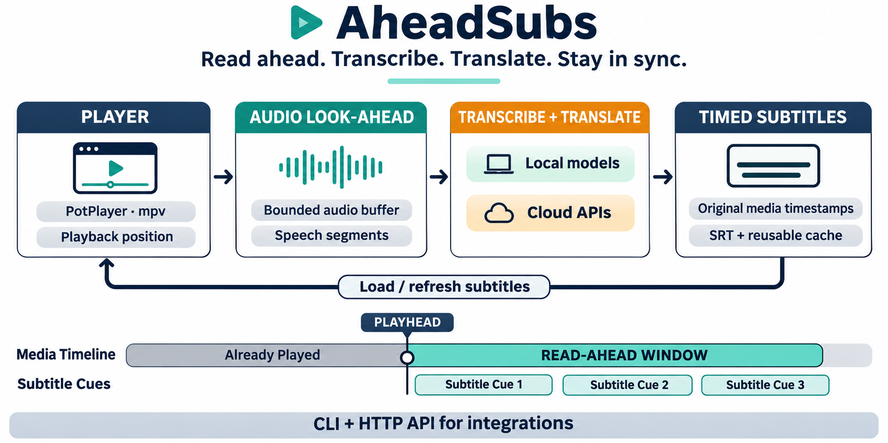

# AheadSubs

[English](README.md) | [简体中文](README.zh-CN.md)

**Subtitles prepared ahead of playback, in the language you choose.**

AheadSubs reads upcoming audio, transcribes speech, translates dialogue, and sends timed subtitles back to your player. Run models on your own computer, connect cloud APIs, or combine both—without waiting for a whole video to finish processing.



*The player supplies the playhead. AheadSubs processes a bounded window ahead of it and loads subtitles on the original media timeline. The illustration shows the workflow, not a screenshot or a zero-latency guarantee.*

## What you get

- **Subtitles while you watch.** Audio look-ahead prepares upcoming dialogue; pause and seek without shifting subtitle timestamps away from the video.
- **Local, cloud, or hybrid processing.** Choose recognition and translation separately. Fully local models keep processing on your computer after downloads; cloud text translation sends subtitle text, while cloud recognition sends audio segments.
- **Readable, synchronized captions.** Speech detection finds natural boundaries. Translated text keeps the source segment's timing; optional bilingual SRT puts the original above the translation.
- **Reusable results.** Completed cues persist to disk. Compatible sessions reuse results instead of repeatedly recognizing and translating the same material. Temporary audio buffers are bounded and released after work completes.
- **Player integration and automation.** Use desktop setup and player controls, or integrate through MCP, the CLI, HTTP playback API and desktop control bridge. Each playback window has its own session; the background service shares models.

## Quick start

Download a package from [Releases](https://github.com/cutexx52/AheadSubs/releases), install it or extract the entire portable archive, and open `AheadSubs.exe`. Choose a stable release for regular use; scheduled builds are marked **Pre-release**. [Windows requirements and package selection](docs/windows.md).

The current desktop uses Chinese labels; English descriptions below include the labels you will see. English documentation does not imply an already fully localized UI.

### Route A — fully local, no API key

1. In **Local models (本地模型)**, install the Qwen3-ASR + NLLB starter preset with **Install local models and start (安装本地模型并启动)**. Without a compatible Vulkan GPU, choose **No available GPU: install CPU setup (无可用显卡：安装 CPU 方案)** for Whisper Small + NLLB.
2. On **Translation (翻译)**, select the video's source language and your subtitle target language. Keep the preset's recognition and translation models, then save/apply and wait for the service to become ready.
3. Configure your player below and start look-ahead. The first model download requires network access; subsequent fully local processing does not require a cloud API key.

### Route B — local recognition + cloud translation

1. Install a local recognition model: Qwen3-ASR on compatible Vulkan hardware, or Whisper Small on CPU. You do not need NLLB if all translation uses a cloud provider.
2. In **Cloud models (云端模型)**, select a provider such as **Alibaba Cloud / Qwen-MT**, enter its API key or select a key file, and choose the matching regional endpoint. Save credentials.
3. On **Translation (翻译)**, keep the local recognition model and select **Qwen-MT Flash** for translation. Choose source/target languages, save/apply, then enable your player.

This hybrid route uploads subtitle text and any enabled text context, not the audio used by the local recognizer. API usage may be billed by your provider. OpenAI, MiniMax and compatible endpoints are alternatives; eligible ChatGPT accounts can use the implemented OAuth connection. [Provider setup and data flow](docs/providers.md).

**Prefer cloud recognition too?** Configure a supported cloud ASR provider (for example Alibaba Cloud ASR with Qwen-MT using the same regional key), select both cloud models on the Translation page, and apply. This uploads short audio segments for recognition as well as text for translation. Local model downloads are unnecessary for those cloud stages; local audio extraction and speech detection still run.

### Connect a player

In **Players (播放器)**, use **One-click setup (一键配置)**, confirm the detected location and restart the player.

| Current integration | Start / stop |
| --- | --- |
| PotPlayer | Open a video; **Ctrl+Alt+J** starts look-ahead and **Ctrl+Alt+K** stops it for that window. Tray controls and native translation-menu extensions are also available. |
| mpv 0.42+ | Enable AheadSubs in the native right-click menu. The Lua integration exposes language and look-ahead settings. |

Wait for initial buffering before expecting captions; processing speed, network latency and seeks affect how far ahead subtitles are ready. Closing settings hides the app to the tray. **Stop and exit (停止并退出)** stops the service and releases models. [Player details and additional adapters](docs/adapters.md).

## Models and extension points

| Area | Available today |
| --- | --- |
| Local recognition | Qwen3-ASR 0.6B / 1.7B through Vulkan; faster-whisper Small through CPU / supported CUDA |
| Local translation | NLLB 600M INT8 through CTranslate2 |
| Cloud processing | Alibaba Cloud ASR / Qwen-MT, OpenAI audio/text APIs, ChatGPT OAuth text translation, MiniMax text translation, compatible endpoints |
| Automation | Shared MCP/CLI operations for status, text translation, whole-file SRT generation and playback sessions; HTTP v1 and JSON desktop bridge |
| New integrations | Implement a player adapter or provider contract without changing the other layers |

For a source checkout with the [development environment](docs/contributing.md) installed:

```powershell
python -m subtitle_relay --help
python -m subtitle_relay serve --asr local --whisper-model small --mt local --device cpu
python -m subtitle_relay clock D:\video\clip.mkv --source ja --target en --ahead 20
```

Run the service and the simulated playhead in separate terminals. For cloud CLI configurations, see the [provider examples](docs/providers.md). For Agent access, open **Integrations (接入) → Enable MCP access (开启 MCP 接入) → Copy MCP configuration (复制 MCP 配置)** and add it to a trusted local client. **Install CLI (安装 CLI)** exposes `aheadsubs` after reopening your terminal. MCP and CLI share operation schemas and errors. See [Agent and CLI integrations](docs/automation.md) for configuration, tools and examples.

## Current support and performance

The packaged application currently targets Windows x64 and readable local files or shared folders. Windows 11 is the primary validation target; Windows 10, ARM64 and other limitations are documented in [Windows support](docs/windows.md). These are today's tested boundaries, not a restriction on future adapters or platforms.

Start with one video on your own hardware. An RTX 4090 test with Qwen3-ASR 1.7B Q4_K and NLLB 600M INT8 sustained four simulated playback sessions for 45 seconds with no sampled buffer exhaustion and a minimum 18.17 seconds ready ahead. It used independent copies of one public Japanese sample, not a long-running mixed-content workload. [Measurements, CPU results and reproduction](docs/performance.md).

## Documentation

Every repository Markdown page offers an English / Simplified Chinese switch. English is the default entry point.

| Start here | What it covers |
| --- | --- |
| [Windows setup](docs/windows.md) | Downloads, packages, installation and supported systems |
| [Desktop guide](docs/desktop.md) | Models, credentials, tray controls and diagnostics |
| [Subtitle tuning](docs/tuning.md) | Recognition, boundaries, look-ahead and bilingual display |
| [Providers](docs/providers.md) | Local/cloud choices, authorization and provider contracts |
| [Agent / CLI integrations](docs/automation.md) | MCP setup, text translation, whole-file SRT and automation |
| [Player integrations](docs/adapters.md) | PotPlayer, mpv and new adapters |
| [HTTP protocol](docs/server.md) / [Architecture](docs/architecture.md) | APIs, sessions, timeline and module boundaries |
| [Contributing](docs/contributing.md) | Development, tests and Agent PR-to-merge workflow |
| [Releases and budget](docs/releases.md) | Automatic previews, build verification and cost controls |

The [Wiki](https://github.com/cutexx52/AheadSubs/wiki) is a navigation entry; maintained documentation lives in this repository. The overview illustration was created with the built-in image generator; its [prompt and accessible description](docs/images/README.md) are included.
