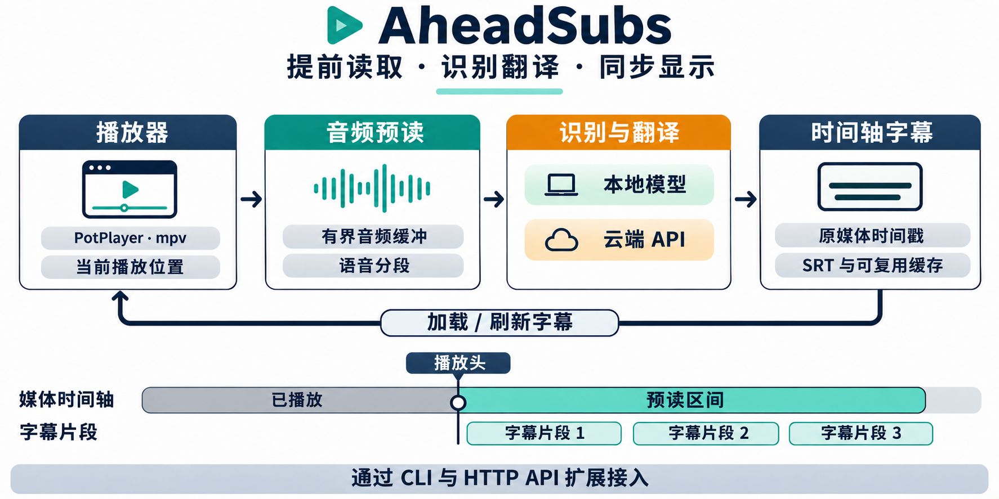

<!-- wiki:intro:start -->
# AheadSubs

[English](README.md) | [简体中文](README.zh-CN.md)

**提前准备字幕，按你选择的语言观看。**

AheadSubs 提前读取即将播放的音频，识别语音、翻译对白，再把带时间轴的字幕送回播放器。可以在自己的电脑上运行模型，也可以接入云端 API，或混合使用两者，无需等待整部视频处理完再开始观看。



*播放器提供播放头；AheadSubs 处理前方有界区间，将字幕按原媒体时间加载。配图用于解释流程，不是界面截图，也不代表零延迟承诺。*

<!-- wiki:intro:end -->

## 可以做什么

- **边看边生成字幕。** 提前读取音频，为即将播放的对白准备字幕；暂停和跳转后仍以视频本身的时间轴为准。
- **本地、云端或混合使用。** 识别和翻译分别选择。全本地模型下载后在自己的电脑上处理；云端文字翻译上传字幕文本，云端识别上传音频片段。
- **可读、同步的字幕。** 通过语音检测寻找自然停顿，译文沿用原对白片段的时间；双语 SRT 可将原文放上行、译文放下行。
- **复用已完成的结果。** 字幕持久化到磁盘，兼容会话复用缓存，不必重复识别、翻译相同内容。临时音频缓冲有界，任务完成即释放。
- **播放器集成与自动化。** 使用桌面助手和播放器入口，也能通过 MCP、CLI、HTTP 播放接口和桌面控制桥接入。每个窗口有独立会话，后台共享模型。

## 快速开始

从 [Releases](https://github.com/cutexx52/AheadSubs/releases) 下载，安装或完整解压便携包后打开 `AheadSubs.exe`。日常使用优先选择稳定版；自动构建标有 **Pre-release**。参见 [Windows 要求与包选择](docs/windows.zh-CN.md)。

快速预设和接入页提供中英文标签，部分已有界面仍为中文。文档按需列出对应标签；文档双语不代表全部 UI 文案已经本地化。

### 路线 A：全本地，不需要 API Key

1. 在 **字幕** 首页展开 **快速预设**。选择 **纯本地 · 独显入门** 使用 Qwen3-ASR 0.6B + CPU NLLB；没有兼容 Vulkan GPU 时选择 **纯本地 · CPU** 使用 Whisper Small + NLLB。对缺少的模型点 **立即下载**，然后 **应用方案**。
2. 在 **字幕** 页选择视频源语言和字幕目标语言，保留方案中的识别及翻译模型，保存并应用，等待服务就绪。
3. 按下文接入播放器并开启预读。首次模型下载需要联网，之后全本地处理无需云端 API Key。

### 路线 B：本地识别 + 云端翻译

兼容 Vulkan 硬件可在快速预设选择 **作者推荐 · 本地识别 + 云端翻译**：组合 Qwen3-ASR 1.7B 和 Qwen-MT Flash，检查缺少的模型/凭据后应用。想选其他本地识别器时按下列步骤配置。

1. 安装一个本地识别模型：兼容 Vulkan 硬件可选 Qwen3-ASR，CPU 可选 Whisper Small。如果全部使用云端翻译，就不需要 NLLB。
2. 在 **云端模型** 选择供应商，例如 **阿里云百炼 / Qwen-MT**，填写 API Key 或选择密钥文件，并选择与密钥匹配的区域端点。保存凭据。
3. 在 **字幕** 页保留本地识别模型，翻译选择 **Qwen-MT Flash**，设置源语言和目标语言，保存并应用，然后开启播放器预读。

混合路线上传字幕文本和启用的文字上下文，不上传由本地识别器处理的音频。API 用量可能产生供应商费用。也可以选择 OpenAI、MiniMax 或兼容接口；符合条件的 ChatGPT 账号可通过已实现的 OAuth 接入。[供应商配置与数据范围](docs/providers.zh-CN.md)。

**识别也想放在云端？** 配置支持的云端 ASR，例如百炼 ASR 与 Qwen-MT 共用区域密钥，在「字幕」页同时选择两个云端模型并应用。这会上传短音频用于识别，并上传文本用于翻译；这两阶段不需下载本地模型，但本地音频提取和语音检测仍会运行。

### 接入播放器

在 **播放器** 页使用 **一键配置**，确认检测到的位置并重启播放器。

| 当前集成 | 启停方式 |
| --- | --- |
| PotPlayer | 打开视频，**Ctrl+Alt+J** 开启当前窗口预读，**Ctrl+Alt+K** 停止。也支持托盘控制和原生字幕翻译菜单扩展。 |
| mpv 0.42+ | 从原生右键菜单启用 AheadSubs。Lua 集成提供语言和预读设置。 |

首次需要等待预缓冲；处理速度、网络延迟和跳转都会影响已准备好的字幕余量。关闭设置窗口会隐藏到托盘，选择 **停止并退出** 可停止服务并释放模型。[播放器详情和扩展适配器](docs/adapters.zh-CN.md)。

## 模型与扩展入口

| 领域 | 当前能力 |
| --- | --- |
| 本地识别 | Vulkan Qwen3-ASR 0.6B / 1.7B；CPU / 受支持 CUDA 环境的 faster-whisper Small |
| 本地翻译 | CTranslate2 NLLB 600M INT8 |
| 云端处理 | 百炼 ASR / Qwen-MT、OpenAI 音频/文本 API、ChatGPT OAuth 文本翻译、MiniMax 文本翻译、兼容端点 |
| 自动化 | MCP/CLI 共用状态、文字翻译、整文件 SRT 生成和播放会话操作；另有 HTTP v1、JSON 桌面桥 |
| 新集成 | 按播放器适配器或 provider 合约扩展，无需改动其他层 |

在安装好[开发环境](docs/contributing.zh-CN.md)的源码目录：

```powershell
python -m aheadsubs --help
python -m aheadsubs serve --asr local --whisper-model small --mt local --device cpu
python -m aheadsubs clock D:\video\clip.mkv --source ja --target en --ahead 20
```

服务和模拟播放头分别在两个终端运行。云端 CLI 配置见[后端示例](docs/providers.zh-CN.md)。Agent 接入：打开 **接入 → 开启 MCP 接入 → 复制 MCP 配置**，添加到受信任的本机客户端。点击 **安装 CLI** 后重开终端即可使用 `aheadsubs`。MCP 与 CLI 共用参数模型和错误码，配置、工具与示例见 [Agent 与命令行接入](docs/automation.zh-CN.md)。

## 当前支持与性能

发行包目前面向 Windows x64，以及后台可读取的本地文件和共享目录。Windows 11 是主要验证目标；Windows 10、ARM64 等限制见 [Windows 支持](docs/windows.zh-CN.md)。这是当前验证边界，不限制未来扩展播放器或平台。

先用自己的设备和素材测试一路。RTX 4090 搭配 Qwen3-ASR 1.7B Q4_K、NLLB 600M INT8 的测试中，四路模拟播放持续 45 秒，无缓冲耗尽采样，最低已译余量 18.17 秒。素材是同一公开日语样本的独立副本，不代表长期混合内容负载。[实测、CPU 结果和复测方式](docs/performance.zh-CN.md)。

<!-- wiki:navigation:start -->
## 文档

[快速开始：本地与云端](README.zh-CN.md#快速开始)

仓库每篇 Markdown 文档均可切换英文和简体中文，默认入口为英文。

| 从这里开始 | 内容 |
| --- | --- |
| [Windows 安装](docs/windows.zh-CN.md) | 下载、包选择、安装与系统支持 |
| [桌面助手](docs/desktop.zh-CN.md) | 模型、凭据、托盘和诊断 |
| [字幕调校](docs/tuning.zh-CN.md) | 识别、边界、预读和双语显示 |
| [模型后端](docs/providers.zh-CN.md) | 本地/云端选择、授权和 provider 合约 |
| [Agent / CLI 接入](docs/automation.zh-CN.md) | MCP 配置、文本翻译、整文件 SRT 与自动化 |
| [播放器集成](docs/adapters.zh-CN.md) | PotPlayer、mpv 和新适配器 |
| [HTTP 协议](docs/server.zh-CN.md) / [架构](docs/architecture.zh-CN.md) | API、会话、时间轴与模块边界 |
| [开发与贡献](docs/contributing.zh-CN.md) | 开发、测试和 Agent PR 到合并流程 |
| [发布与预算](docs/releases.zh-CN.md) | 自动预览版、构建验证和成本控制 |
| [性能](docs/performance.zh-CN.md) | 实测结果与设备限制 |
| [Windows 打包](packaging/README.zh-CN.md) | 安装包与便携版构建 |
| [Wiki 发布](docs/wiki.zh-CN.md) | 自动同步双语导航与图片引用 |
| [许可证](docs/licenses.zh-CN.md) | MIT 源码许可、模型限制与再分发审计 |

<!-- wiki:navigation:end -->

[Wiki](https://github.com/cutexx52/AheadSubs/wiki) 为导航入口，维护中的文档保存在仓库。概览图使用内置图像生成工具制作，[提示词与无障碍说明](docs/images/README.zh-CN.md)随项目保存。

## 许可证

项目自有代码采用 [MIT](LICENSE)。第三方组件遵守各自条款。尤其是 NLLB 权重限非商业使用，CUDA 运行库为专有软件；商用或再分发二进制前请查看[依赖与模型审计](docs/licenses.zh-CN.md)。
